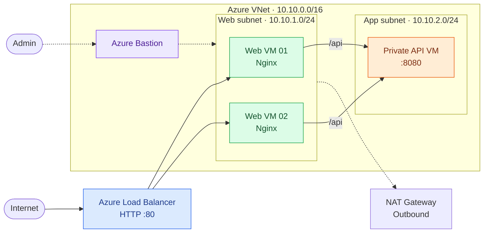
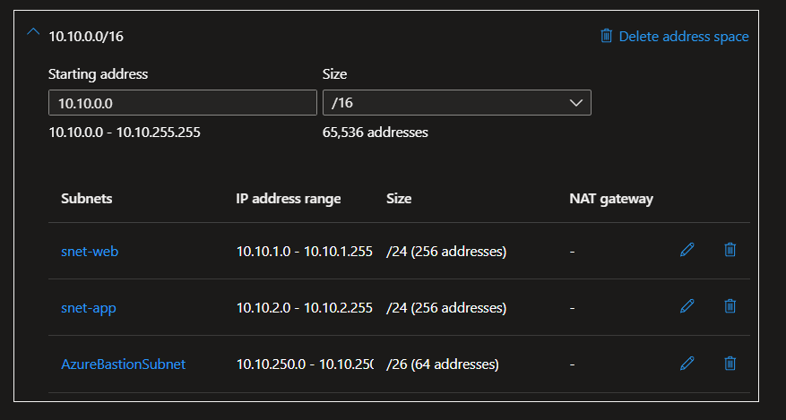
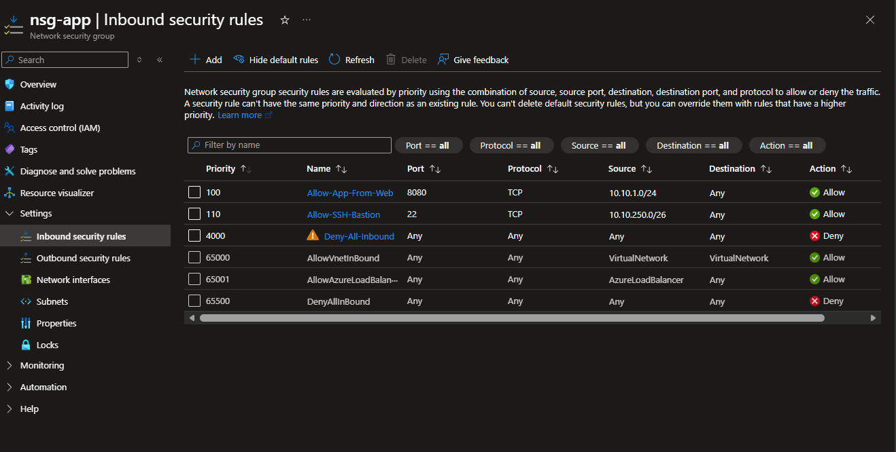
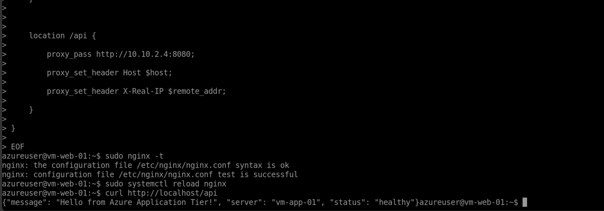
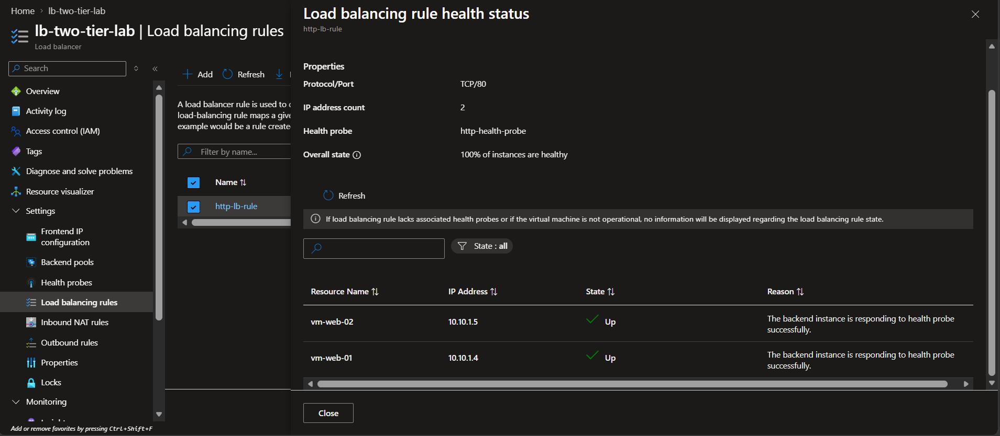
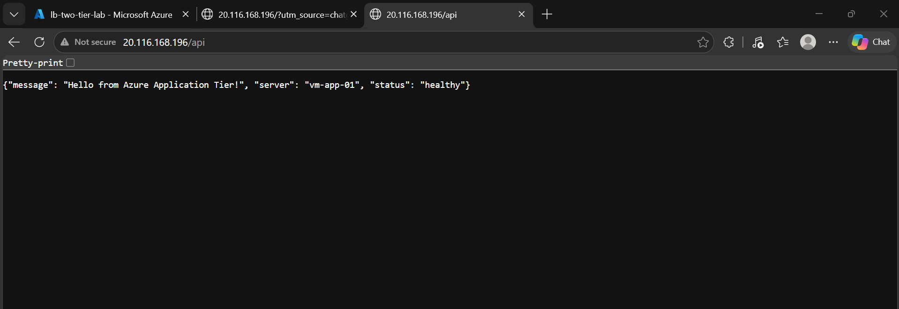
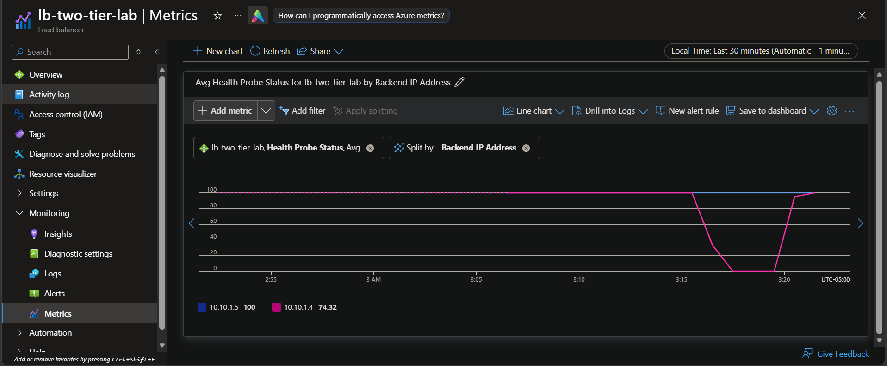

# Azure Two-Tier VNet & Bastion Lab

**Hands-on Azure infrastructure lab demonstrating network segmentation, HTTP load balancing, secure administrative access, and web-to-application connectivity.**

[View architecture and request-flow diagrams](docs/architecture.md)

## Overview

This lab deploys two Ubuntu/Nginx web servers in a dedicated web subnet and an application VM in a separate private subnet. A public **Azure Standard Load Balancer** distributes inbound HTTP traffic between the web servers. Nginx proxies `/api` requests from the web tier to the application VM over the VNet. Azure Bastion provides administrative access without requiring public SSH endpoints on each VM.

**Scope:** An educational two-tier environment—not a production, zone-redundant, zero-downtime architecture.

## Architecture

**Traffic:** solid lines = HTTP/API; dashed lines = administration/outbound. Web and app tiers use separate NSGs (`nsg-web`, `nsg-app`). [Detailed architecture and request flow](docs/architecture.md).

## Azure resources

| Component | Lab configuration |
|---|---|
| Resource group | `rg-two-tier-lab` |
| Region | Canada Central |
| Virtual network | `vnet-two-tier-lab` |
| Web subnet | `snet-web` — `10.10.1.0/24` |
| App subnet | `snet-app` — `10.10.2.0/24` |
| Bastion subnet | `AzureBastionSubnet` — `10.10.250.0/26` |
| Web VMs | `vm-web-01` (`10.10.1.4`), `vm-web-02` (`10.10.1.5`) |
| App VM | `vm-app-01` — API on port `8080` |
| Load balancer | `lb-two-tier-lab`, Standard SKU |
| Network security | `nsg-web`, `nsg-app` |
| Other services | Azure Bastion, NAT Gateway |

IP addresses are from the lab environment. The VM, load-balancer and subnet names are included to make the design reproducible; this repository **does not** contain a one-click infrastructure deployment.

## What I validated

- Both web backends displayed **100% healthy** in the Azure Load Balancer backend health view at the time of testing.
- HTTP requests reached the web tier through the public load balancer endpoint.
- Nginx reverse proxy routing on `/api` successfully reached the private application VM.
- The application returned a JSON response containing `"status": "healthy"`.

These observations establish **functional connectivity and probe health**, not tested automatic failover, resilience under load, or an uptime SLO.

## Project screenshots

These screenshots document the deployed configuration and tests performed during the lab. [Browse all 21 screenshots](screenshots/).

### 1. Virtual network and subnets

*Virtual network address space (10.10.0.0/16) with dedicated web, application and Bastion subnets.*

### 2. Application-tier network security

*Application subnet permits TCP 8080 from the web subnet and SSH from the Bastion subnet, with a higher-priority custom deny rule for other inbound traffic.*

### 3. Nginx reverse proxy and private API

*Nginx forwards `/api` requests to the private app at `10.10.2.4:8080`; the configuration test and local proxy request succeeded.*

### 4. Load balancer backend health

*Both Nginx backends reported healthy for the HTTP load-balancing rule at the time of testing.*

### 5. Application response through public endpoint

*The public `/api` endpoint returned a JSON response from `vm-app-01` with `"status": "healthy"`.*

### 6. Health probe change and recovery

*The Azure metric shows one backend's health-probe status falling and returning to healthy. This **does not by itself establish automatic recovery or uninterrupted client traffic**.*

## Example request flow

1. A client sends an HTTP request to the load balancer's public IP.
2. The load balancer forwards the request to one of the healthy Nginx web servers.
3. For `/api`, Nginx forwards the request to the application VM on port `8080`.
4. The application returns JSON through the web server to the client.

## Documentation

- [Architecture and network design](docs/architecture.md)
- [Validation checklist and observed results](docs/validation.md)
- [Troubleshooting notes](docs/troubleshooting.md)
- [Sample Nginx reverse-proxy configuration](nginx/reverse-proxy.example.conf)
- [Complete screenshot evidence (21 images)](screenshots/)

## Key takeaways

- VM power state, backend probe health, and application-layer behavior are separate checks.
- Subnet boundaries and NSG rules must support the intended traffic flow.
- Bastion separates administrative access from the public application entry point.
- A load balancer and a working API path are building blocks of reliability—not proof of end-to-end high availability.

## Potential improvements

Add infrastructure as code, application logs and metrics, alerting, controlled failure tests, HTTPS, and resilience/load testing. These are **future enhancements**, not implemented or validated features of this lab.

## Cost and security

Azure VMs, Bastion, NAT Gateway, and Standard Load Balancer may incur charges while provisioned. Tear down unused resources and check Azure Cost Management. Do not commit passwords, access tokens, private keys, or connection strings.

**Author:** [Nischay192](https://github.com/Nischay192)
