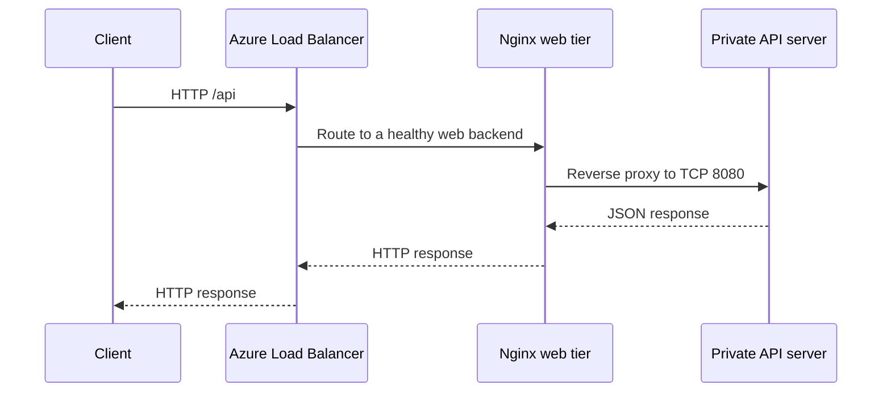

# Architecture and network design

## Objective

Build a two-tier Azure lab with load-balanced Nginx web servers, one private application VM, segmented subnets, Azure Bastion access, and outbound NAT connectivity.

## Network

| Component | Value |
|---|---|
| Resource group | `rg-two-tier-lab` |
| Region | Canada Central |
| VNet | `vnet-two-tier-lab` |
| Web subnet | `snet-web`: `10.10.1.0/24` |
| App subnet | `snet-app`: `10.10.2.0/24` |
| Bastion subnet | `AzureBastionSubnet`: `10.10.250.0/26` |
| Web server 1 | `vm-web-01`: `10.10.1.4` |
| Web server 2 | `vm-web-02`: `10.10.1.5` |
| App server | `vm-app-01`: private API port `8080` |

## Request path

The Standard Load Balancer exposes the public HTTP entry point. Both web VMs are members of its backend pool. The private application VM is on the separate app subnet; Nginx forwards `/api` requests to it. NSGs `nsg-web` and `nsg-app` provide network controls. Azure Bastion is used for VM administration; the NAT Gateway is for outbound connectivity.

## Design limitations

The app tier has a **single VM**, so the architecture still has a single point of failure. Backend health and end-to-end application connectivity were checked, but controlled failure testing, availability-zone resilience, and an uptime SLO were **not** demonstrated. This is a lab, not a production deployment.
