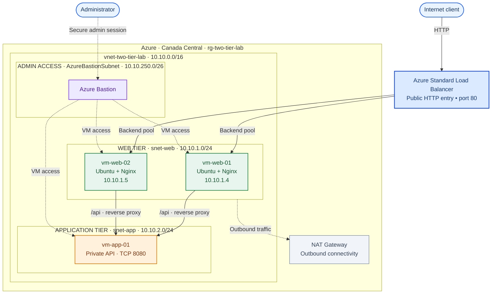
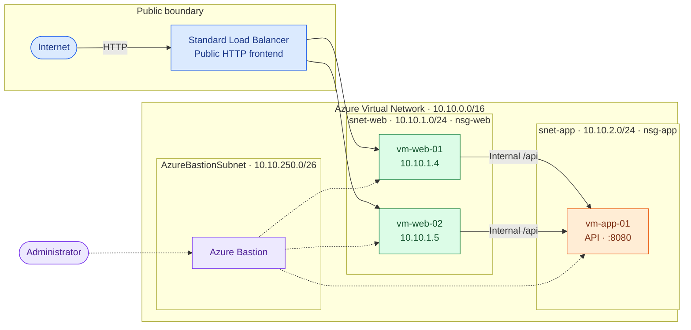
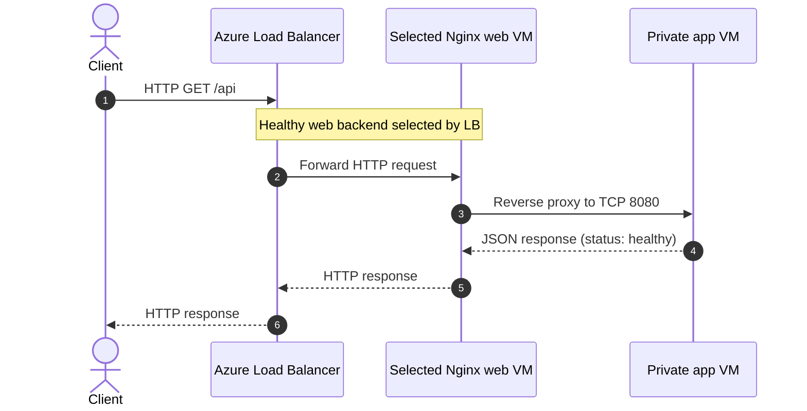

# Architecture and network design

## Design goal

Demonstrate a segmented two-tier Azure deployment with **one public HTTP entry point**, **two Nginx web VMs**, a **private application VM**, and **separate administrative and outbound access paths**. This is a documented lab, not a production reference architecture.

## 1. Infrastructure at a glance

**Reading the diagram:** Solid arrows show application requests; dashed arrows show administrative and outbound connectivity. Network Security Groups (`nsg-web`, `nsg-app`) control the respective subnet traffic; the precise NSG rules are not reproduced here. NAT Gateway is shown as the outbound component without asserting an unverified subnet association.

## 2. Network and security boundaries

| Boundary | Service / configuration | Role |
|---|---|---|
| Public endpoint | Standard Load Balancer | Distributes inbound HTTP across the web backends |
| Web subnet | `snet-web` (`10.10.1.0/24`), `nsg-web` | Hosts the two Ubuntu/Nginx VMs |
| App subnet | `snet-app` (`10.10.2.0/24`), `nsg-app` | Hosts the private API VM on port `8080` |
| Administration | Azure Bastion, `AzureBastionSubnet` (`10.10.250.0/26`) | VM access without exposing per-VM public SSH endpoints |
| Egress | NAT Gateway | Outbound network connectivity |

The lab uses `rg-two-tier-lab` in **Canada Central** and `vnet-two-tier-lab` (documented as `10.10.0.0/16`). Recorded web VM addresses were `10.10.1.4` and `10.10.1.5`. The app VM's private IP is not included because it was not captured in the available notes.

## 3. End-to-end request flow

**Validated during the lab:** Both load balancer backends displayed 100% healthy, HTTP reached the web tier, and `/api` returned a successful response from the private application tier. See [validation](validation.md).

## 4. Security and operational notes

- The web tier is the public application entry path; the app tier is reached internally through the web VMs.
- Two separate subnets and NSGs make tier-to-tier dependencies explicit.
- Azure Bastion is the administration path; NAT Gateway is an outbound traffic component, not a replacement for inbound load balancing.
- Nginx proxy configuration and the application listener must agree on the internal port and URL path.
- The diagram is conceptual. Exact NSG rule values and NAT Gateway subnet associations should be confirmed against screenshots or exports before adding them here.

## 5. Reliability limitations

The web tier contains **two** VMs, but the application tier contains **one** VM and remains a single point of failure. This lab verified connectivity and backend probe health. It did **not** establish zone redundancy, automated recovery, failover under fault injection, performance at scale, or a production uptime guarantee.
